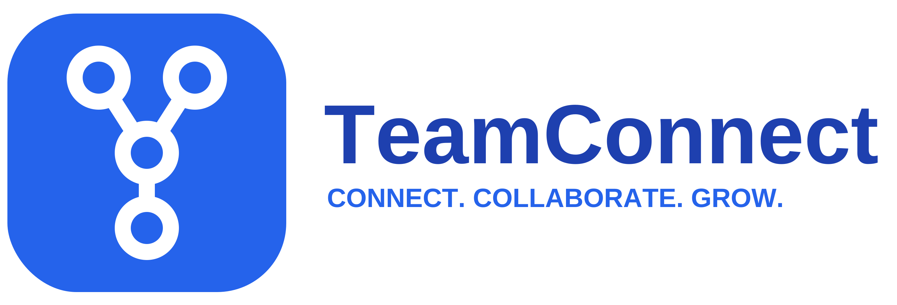

# TeamConnect – Group Profile Application

<p align="center">
  
</p>

TeamConnect is a responsive mobile group profile application developed
using Flutter and Firebase Authentication for nine NDT Information
Technology students at the Institute of Technology, University of
Moratuwa (ITUM).

The application provides a secure authentication system, a shared
home screen, and individual member profile pages with unique designs.

## Academic Information

- **Institute:** Institute of Technology, University of Moratuwa
- **Division:** Information Technology
- **Programme:** National Diploma in Technology (NDT)
- **Module:** Mobile Communication
- **Assessment:** Continuous Assessment 02 (CA02)
- **Group Size:** 9 Members


## Features

- Firebase email and password authentication
- Login form validation and error handling
- Password visibility toggle
- Persistent authentication session
- Automatic navigation using AuthGate
- Responsive home page with nine member cards
- Search members by name or registration number
- Individual member profile navigation
- Unique individual profile designs
- Interactive UI using StatefulWidget and setState()
- Profile photographs
- Functional professional and social media links
- Logout confirmation
- Android and web compatibility

## Technology Stack

| Technology | Purpose |
|---|---|
| Flutter | Cross-platform application development |
| Dart | Programming language |
| Firebase Core | Firebase configuration |
| Firebase Authentication | User authentication |
| Material 3 | User interface design |
| setState() | State management |
| url_launcher | External link navigation |
| Git & GitHub | Version control and team collaboration |

## Group Members and Individual Contributions

Each member is responsible for developing their own individual
profile page with a unique design.

| Registration No. | Name | Assigned Profile File | Status |
|---|---|---|---|
| 23IT0480 | Ms M R Hanan | member1_screen.dart | Completed |
| 23IT0481 | Ms W R K W Hansamali | member2_screen.dart | Completed |
| 23IT0482 | Ms H M C B Herath | member3_screen.dart | Completed |
| 23IT0485 | Ms V Inthumathy | member4_screen.dart | Completed |
| 23IT0486 | Ms R V P A Jayamali | member5_screen.dart | Completed |
| 23IT0487 | Ms G W T Jayampathi | member6_screen.dart | Completed |
| 23IT0488 | Ms W D C G Jayarathna | member7_screen.dart | Completed |
| 23IT0490 | Mr K A S K Kapuhenthuduwa | member8_screen.dart | Pending |
| 23IT0491 | Ms W K Y Y Karunaratna | member9_screen.dart | Pending |

### Common Application Development

**23IT0480 – Ms M R Hanan (Reezma Hanan)**

- Initial Flutter project setup
- Firebase configuration
- Authentication service
- Login and logout functionality
- AuthGate implementation
- Common home screen
- Member search functionality
- Profile navigation
- Individual Member 1 profile page
- GitHub repository setup and integration

Members 2–9 are assigned their own profile pages. See the table
above for each profile's current status.

## Project Structure

```text
TeamConnect/
├── android/
├── ios/
├── linux/
├── macos/
├── web/
├── windows/
├── assets/
│   ├── branding/
│   ├── inthumathy/
│   │   ├── certificates/
│   │   └── images/
│   ├── jayampathi/
│   │   └── images/
│   └── reezma/
│       ├── certificates/
│       ├── images/
│       └── svgs/
├── images/
│   └── screenshots/
├── lib/
│   ├── main.dart
│   ├── firebase_options.dart
│   ├── assets/
│   │   └── images/
│   ├── models/
│   │   └── member.dart
│   ├── services/
│   │   └── auth_service.dart
│   ├── screens/
│   │   ├── login_screen.dart
│   │   ├── home_screen.dart
│   │   └── members/
│   │       ├── member1_screen.dart
│   │       ├── member2_screen.dart
│   │       ├── member3_screen.dart
│   │       ├── member4_screen.dart
│   │       ├── member5_screen.dart
│   │       ├── member6_screen.dart
│   │       ├── member7_screen.dart
│   │       ├── member8_screen.dart
│   │       └── member9_screen.dart
│   └── widgets/
│       ├── main.dart
│       └── member_placeholder.dart
├── test/
│   └── widget_test.dart
├── pubspec.yaml
├── .gitignore
└── README.md
```

## Prerequisites

Before running the application, ensure that the following
software is installed:

- Flutter SDK
- Dart SDK (included with Flutter)
- Git
- Visual Studio Code or Android Studio
- Flutter and Dart IDE extensions
- Google Chrome or Android emulator

Check your Flutter installation:

```bash
flutter doctor
```

## Installation and Setup

### Step 1 – Clone the Repository

```bash
git clone https://github.com/reezmahanan/TeamConnect.git
```

### Step 2 – Open the Project

```bash
cd TeamConnect
code .
```

### Step 3 – Install Dependencies

```bash
flutter pub get
```

### Step 4 – Check Available Devices

```bash
flutter devices
```

### Step 5 – Run the Application

For Google Chrome:

```bash
flutter run -d chrome
```

For an Android emulator or connected mobile device:

```bash
flutter run
```

## Firebase Authentication Setup

The application is already connected to the shared Firebase
project.

The following configuration files must be preserved:

- `lib/firebase_options.dart`
- `android/app/google-services.json`

Email/Password authentication is used for the login system.

Group members do not need to create separate Firebase projects
or run FlutterFire configuration again.

Do not modify the existing Firebase configuration without
informing the group.

## Evaluation – Test Account

A dedicated Firebase Authentication test account is provided
for application testing.

- **Email:** teamconnect@example.com
- **Password:** TeamConnect@2026


## Application Workflow

1. Launch the TeamConnect application.
2. Enter a registered email address and password.
3. Firebase Authentication validates the credentials.
4. Successful authentication redirects to the home screen.
5. The home screen displays all nine group members.
6. Select a member to view their individual profile.
7. Use back navigation to return to the home screen.
8. Select Logout and confirm to return to the login screen.

## Individual Profile Requirements

Each group member must develop their assigned individual
profile page.

### Required Information

- Full Name
- Registration Number
- Address
- Email Address
- Academic Qualifications
- Personal Photograph
- Soft Skills
- Special Talents (if applicable)

### Optional Information

- Technical Skills
- Personal Projects
- Professional Certifications
- Achievements
- Hobbies and Interests
- Leadership Experience
- GitHub, LinkedIn and Portfolio Links

### Design Requirements

Each individual profile must have a unique visual design.

Members should use different:

- Colour schemes
- Layout structures
- Typography
- UI components
- Profile header styles
- Cards and sections
- Interactive elements

Simply copying another member's design and replacing their
personal information is not acceptable.

Ensure that each profile is responsive, scrollable, visually
appealing and functional.

Use StatefulWidget and setState() for interactive features
where appropriate.

## Adding Profile Photographs

Store your personal photograph in the asset folder already
registered for your profile. The shared `lib/assets/images/`
folder is registered in `pubspec.yaml` and can be used for new
member photographs.

```text
lib/assets/images/
```

Use your registration number as the image filename.

Example:

```text
lib/assets/images/23IT0481.jpg
```

Reezma Hanan's existing photograph is stored at:

```text
assets/reezma/images/profile/reezma.jpg
```

If you use a different folder, register it under the existing
`flutter` section in `pubspec.yaml`.

Example:

```yaml
flutter:
  uses-material-design: true

  assets:
    - assets/images/
```

Do not create a duplicate `flutter` section.

After changing `pubspec.yaml`, run:

```bash
flutter pub get
```

Use the corresponding image path in your individual
profile screen.

## GitHub Collaboration Guide

All members must contribute using their own GitHub accounts.

### Step 1 – Accept the Collaborator Invitation

Send your GitHub username to the repository owner and accept
the collaborator invitation.

### Step 2 – Clone the Repository

```bash
git clone https://github.com/reezmahanan/TeamConnect.git
cd TeamConnect
```

If you have already cloned the repository, skip this step.

### Step 3 – Update the Main Branch

```bash
git checkout main
git pull origin main
```

### Step 4 – Create Your Individual Branch

Use your registration number as your branch name.

Example:

```bash
git checkout -b 23IT0481-profile
```

Replace `23IT0481` with your own registration number.

### Step 5 – Develop Your Assigned Profile Page

All individual profile pages are located inside:

```text
lib/screens/members/
```

Find your assigned file using the group member allocation table.

For example, member 23IT0481 should develop:

```text
lib/screens/members/member2_screen.dart
```

Preserve the existing screen class name to ensure that
navigation continues to work correctly.

### Step 6 – Test Your Changes

```bash
flutter pub get
dart format lib/screens/members/member2_screen.dart
flutter analyze
flutter run -d chrome
```

Replace the filename with your assigned profile filename.

Ensure that your profile opens correctly from the home screen
and that there are no compilation or layout errors.

### Step 7 – Check Your Changes

```bash
git status
```

Ensure that only your intended files have been modified.

### Step 8 – Stage Your Files

Example for member 23IT0481:

```bash
git add lib/screens/members/member2_screen.dart
git add assets/images/23IT0481.jpg
```

If pubspec.yaml was intentionally modified, also run:

```bash
git add pubspec.yaml
```

### Step 9 – Commit Your Changes

```bash
git commit -m "feat: add individual profile for 23IT0481"
```

### Step 10 – Push Your Branch

```bash
git push -u origin 23IT0481-profile
```

Replace the example registration number and filenames with
your own details.

### Step 11 – Create a Pull Request

1. Open the TeamConnect GitHub repository.
2. Select your individual branch.
3. Click Compare & pull request.
4. Set the base branch to `main`.
5. Enter a meaningful title and description.
6. Create the pull request.
7. Inform the group representative for review.
8. Merge only after the changes have been reviewed.

## Branch Allocation

| Registration Number | Branch Name |
|---|---|
| 23IT0480 | 23IT0480-profile |
| 23IT0481 | 23IT0481-profile |
| 23IT0482 | 23IT0482-profile |
| 23IT0485 | 23IT0485-profile |
| 23IT0486 | 23IT0486-profile |
| 23IT0487 | 23IT0487-profile |
| 23IT0488 | 23IT0488-profile |
| 23IT0490 | 23IT0490-profile |
| 23IT0491 | 23IT0491-profile |

Note: Member 1's initial profile implementation is already
included in the main branch.

## Collaboration Rules

- Develop only your assigned individual profile page.
- Do not modify other members' profile pages.
- Do not create a separate Flutter project.
- Do not modify Firebase configuration.
- Do not change common application files without discussion.
- Do not rename existing profile screen classes.
- Do not push directly to the main branch.
- Do not commit unnecessary files or build outputs.
- Do not expose private API keys or passwords.
- Use your own GitHub account for commits.
- Write meaningful commit messages.
- Test your implementation before creating a pull request.

Individual GitHub contributions will be considered during
the assignment evaluation.

## Testing Checklist

- [ ] Application launches successfully
- [ ] Valid login credentials work
- [ ] Invalid credentials display an error message
- [ ] Authentication session is maintained
- [ ] Successful login opens the home screen
- [ ] All nine members are displayed
- [ ] Member search functions correctly
- [ ] All nine individual profile pages are completed
- [ ] All profile photographs display correctly
- [ ] Individual profile designs are unique
- [ ] State management functionality works
- [ ] Back navigation works correctly
- [ ] Logout returns to the login screen
- [ ] Android and web layouts are responsive
- [ ] External links work correctly
- [ ] All member contributions are merged
- [ ] Lecturer test account is verified

## Code Quality

Run the following commands before final submission:

```bash
flutter pub get
dart format lib
flutter analyze
flutter test
```

Resolve compilation errors and relevant analysis warnings
before merging changes into the main branch.

Update any outdated tests so that they reflect the application.

## Screenshots

### Login


### Home


### Logout


Individual profile screenshots will be added after all profile
pages are completed and integrated.

## Project Timeline

| Milestone | Target Date |
|---|---|
| Initial project setup | 22 November 2026 |
| Individual profile development | 24 November 2026 |
| Integration and testing | 25 November 2026 |
| Final submission | 26 November 2026 |

## Repository

GitHub Repository:

https://github.com/reezmahanan/TeamConnect

## Acknowledgements

Developed as part of the Mobile Communication Continuous
Assessment 02 by nine NDT Information Technology students
at the Institute of Technology, University of Moratuwa.

## Authors

TeamConnect Development Team – NDT Information Technology, ITUM.

---

Developed with Flutter & Firebase | TeamConnect 2026